# Wayfindr Theme

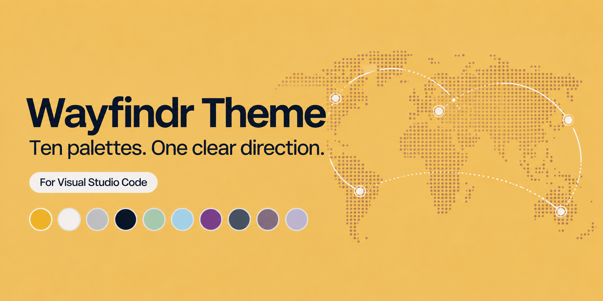

Warm yellow or quiet gray. A clear way forward.

Ten VS Code color themes inspired by [Wayfindr](https://wayfindr.io/), with yellow and gray surfaces, gold accents, botanical greens, soft blues, and plum syntax colors.

## The themes

### Gray palettes

Six neutral gray variants offer three levels of contrast in both light and dark:

| Level | Dark theme | Light theme | Feel |
| --- | --- | --- | --- |
| Soft | **Wayfindr Gray Dark Soft** | **Wayfindr Gray Light Soft** | Closer surface tones, muted syntax and gold, gentler text contrast |
| Standard | **Wayfindr Gray Dark** | **Wayfindr Gray Light** | Balanced gray surfaces, clear syntax, restrained gold accents |
| Contrast | **Wayfindr Gray Dark Contrast** | **Wayfindr Gray Light Contrast** | Stronger text, visible borders, outlined selections, clearer indentation |

Soft and Standard keep tested text colors at least **4.5:1** against the editor, sidebar, and raised widget surfaces. Contrast targets at least **7:1** for the same text colors and **3:1** for borders on those surfaces. Soft reduces separation without making comments faint. The gray family uses neutral surfaces and lower-saturation syntax colors; the Wayfindr accents stay recognizable.

These Contrast variants use the normal light/dark UI bases with explicit boundary colors. They are not dedicated OS high-contrast themes or a full accessibility certification.

| Level | Gray Dark | Gray Light |
| --- | --- | --- |
| Soft | 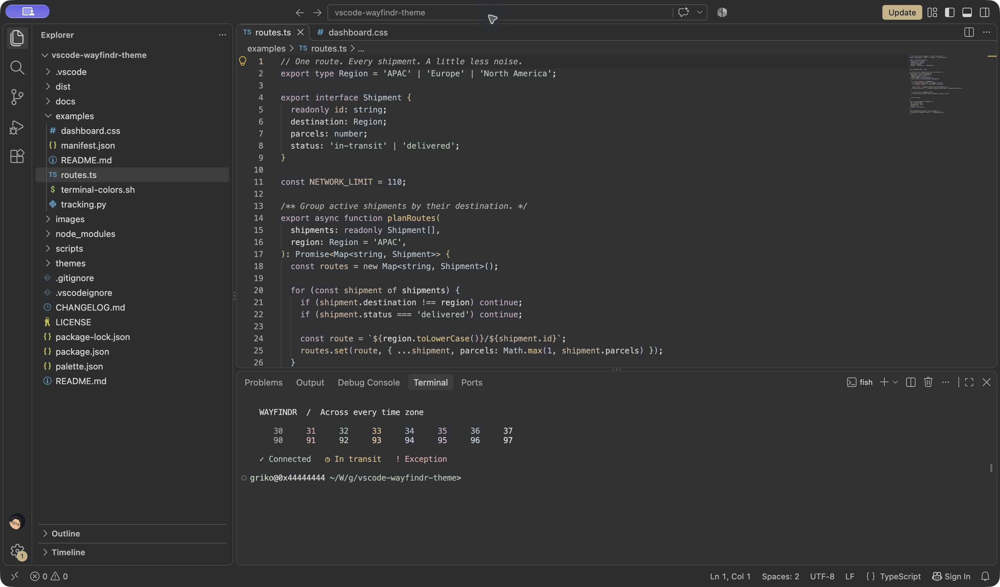 | 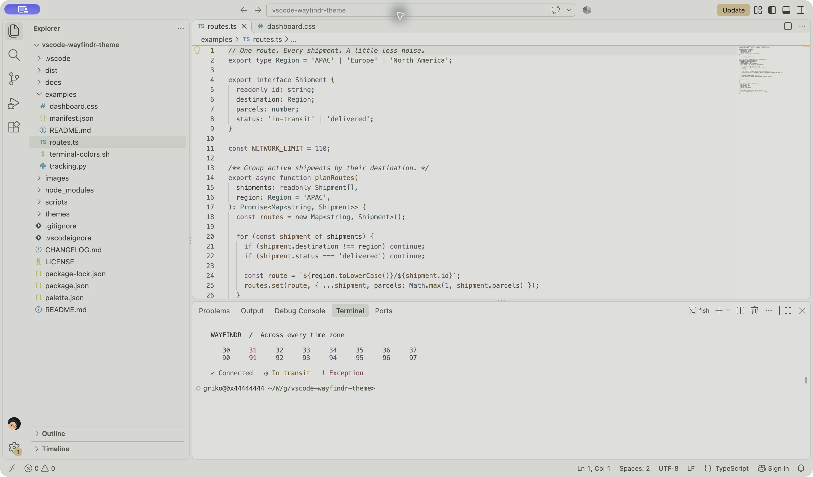 |
| Standard | 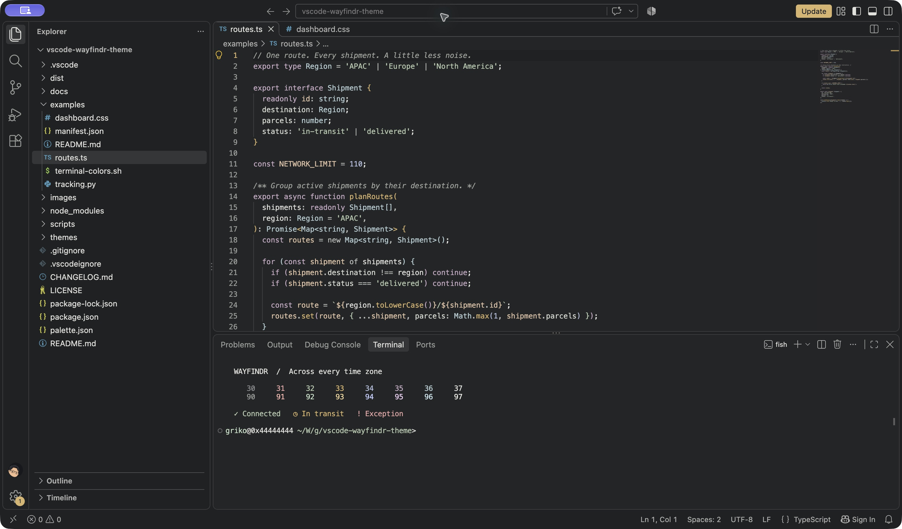 | 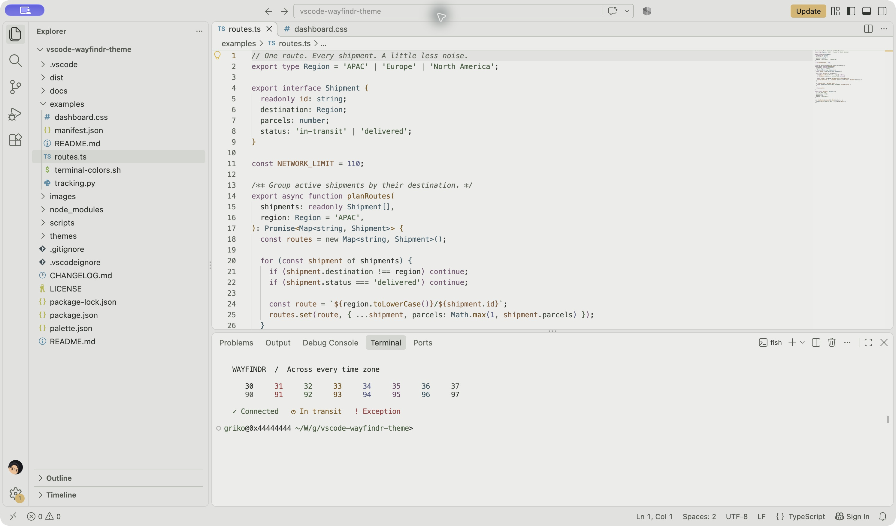 |
| Contrast | 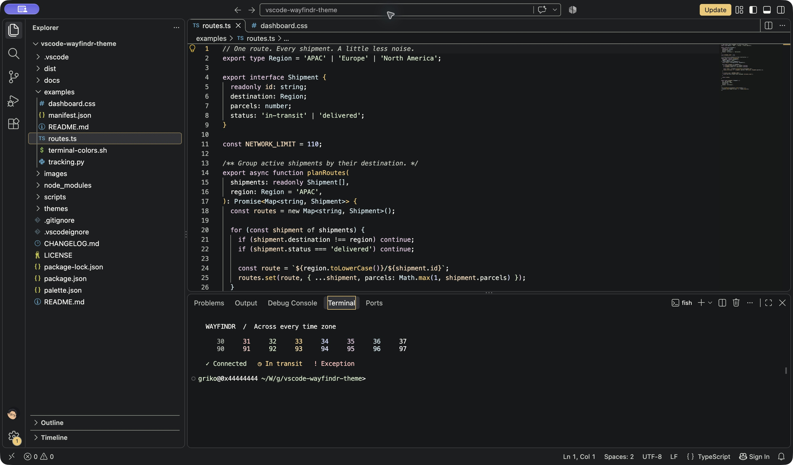 | 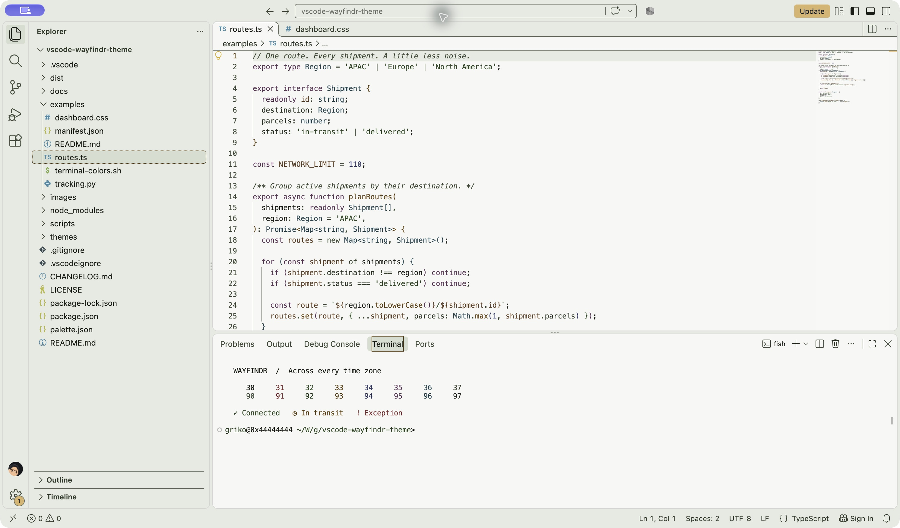 |

### Yellow palettes

The primary pair carries a muted version of Wayfindr's yellow through the editor, sidebar, terminal, and menus:

- **Wayfindr Dark** — warm charcoal `#242117` with a subtle yellow undertone, golden functions, sage strings, and soft plum keywords.
- **Wayfindr Light** — muted butter yellow `#F3E5BD`, deeper yellow sidebar layers, and darker syntax colors tuned for contrast.

| Wayfindr Dark | Wayfindr Light |
| --- | --- |
| 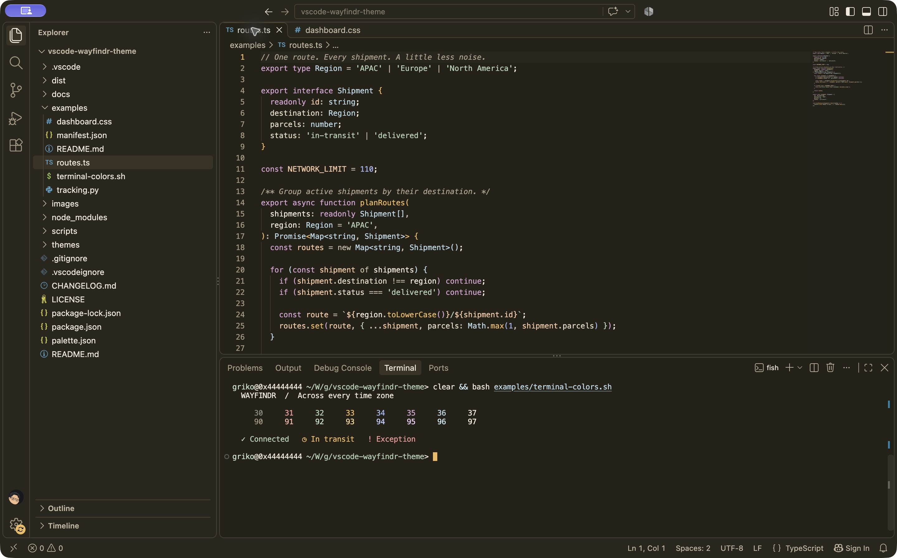 | 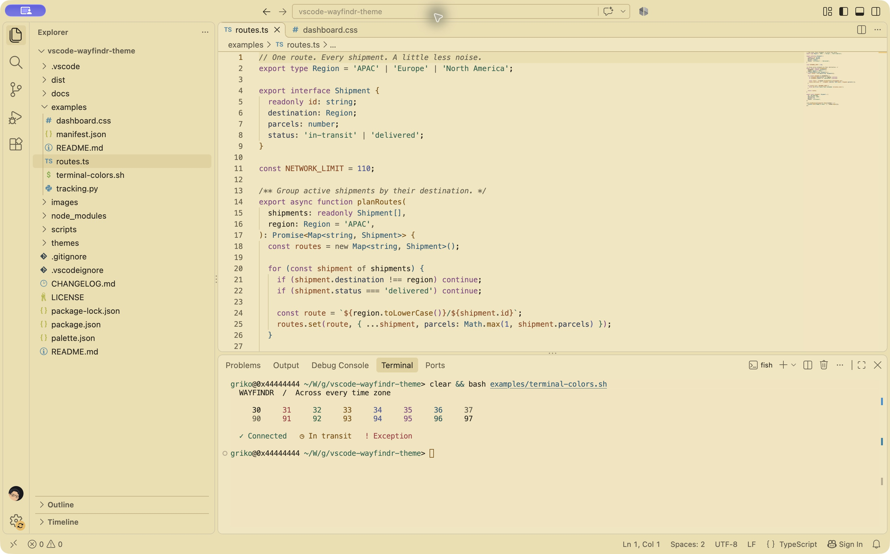 |

The original palettes remain available as alternatives:

**Wayfindr Night** uses Wayfindr's ink `#101828` as its editor background, with gold functions, sage strings, sky types, and soft plum keywords.

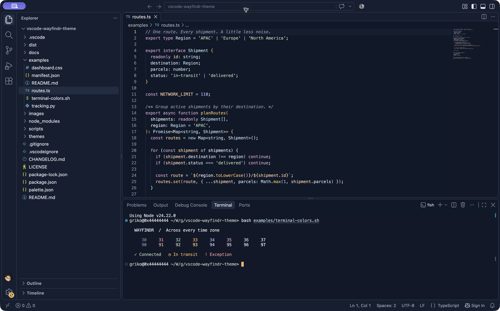

**Wayfindr Day** uses warm paper `#FCFAF4`, with darker amber, forest, blue, and plum syntax colors. Gold stays bright on buttons and badges, with ink labels.

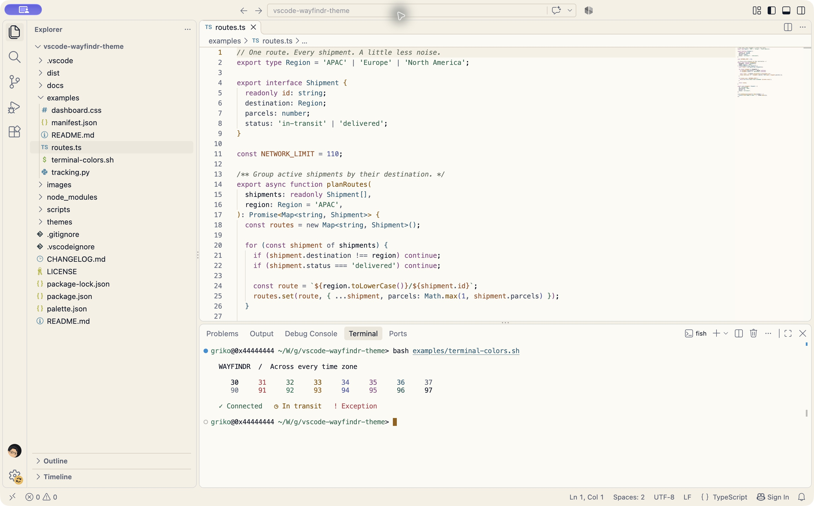

All ten variants include workbench colors, terminal ANSI colors, diff and Git decorations, diagnostics, bracket colors, completion widgets, TextMate scopes, and semantic tokens. The extension has no runtime code or runtime dependencies.

## Install locally

Requires VS Code 1.85 or newer. Visual verification is recorded in [docs/verification.md](docs/verification.md).

```sh
npm ci
npm run build
npm run package
npm run sideload
```

The sideload command installs into your usual Insiders profile. For a separate preview, open a named profile first, then install the VSIX into it:

```sh
code-insiders --profile 'Wayfindr Preview' . examples/routes.ts
npm run sideload -- --profile 'Wayfindr Preview'
```

Open **Preferences: Color Theme** (`Cmd+K Cmd+T` on macOS) and search **Wayfindr**. Choose the yellow Dark/Light pair, a Gray variant, or the original Night/Day palettes.

For automatic system appearance switching, set **Workbench: Preferred Dark Color Theme** to **Wayfindr Dark** and **Workbench: Preferred Light Color Theme** to **Wayfindr Light**, then enable **Window: Auto Detect Color Scheme**.

For stable VS Code, use `code --install-extension dist/wayfindr-theme-0.3.0.vsix`.

## Palette

These values were extracted from Wayfindr's live homepage and stylesheet on October 19, 2026. The theme's background layers and some syntax colors are adaptations for legibility.

| Color | Source hex | Theme role |
| --- | --- | --- |
| Gold | `#EFBA5A` | Primary accent, Night functions, buttons |
| Ink | `#101828` | Night background, Day foreground |
| Plum | `#A05F9A` | Basis for keyword colors |
| Green | `#378264` | Basis for status and string colors |
| Sage | `#B1CEB3` | Night strings |
| Sky | `#B8D8E4` | Night types and informational states |
| Periwinkle | `#A6B6F1` | Night numbers |
| Pink | `#F6D4FB` | Bright terminal magenta |
| Forest | `#1C5653` | Deep green companion |
| Cream | `#FDF4D7` | Inspiration for Day's warm surfaces |
| Cloud | `#FCFCFD` | Bright text and accents |

The editable source of truth is [palette.json](palette.json). Run `npm run build` after changing it; generated JSON files in `themes/` are included so the extension can load directly.

The Dark and Light palettes inherit their syntax foundations from Night and Day, then override the background layers, neutral colors, and any syntax colors that need more contrast. The Gray palettes add their own neutral surfaces, syntax tones, and contrast levels. All four existing theme files remain unchanged.

`npm run check` checks generated files, manifest contributions, color formats, neutral gray surfaces, and text contrast. Primary text, syntax, comments, and secondary text must reach at least **4.5:1** against each of the three standard surfaces in every variant, or **7:1** for the Gray Contrast variants. It also checks stronger Contrast borders and that main text contrast increases from Soft to Standard to Contrast. These checks do not certify the whole UI against an accessibility standard.

## Develop

Build tooling requires Node.js 22.11 or newer. Open the folder in VS Code and press **F5** to launch the **Preview Wayfindr themes** configuration. Pick a variant in the Extension Development Host; saved theme JSON changes reload automatically.

Use **Developer: Inspect Editor Tokens and Scopes** to inspect TextMate and semantic token colors. The `examples/` folder includes TypeScript, Python, CSS, JSON, and Markdown specimens.

The VSIX includes the manifest, generated themes, palette, PNG images, documentation, changelog, and license. Development scripts, examples, and dependencies are excluded.

## Releases

This project follows the same Changesets workflow as the sibling Copilot Chat extensions. For a user-visible change, run `npm run changeset` and commit the generated note with the implementation. CI validates and packages the extension on Node.js 22, 24, and 26.

The Release workflow opens a version pull request. After that pull request is reviewed and merged, it validates the package, publishes the VSIX under `grikomsn` using the repository's `VSCE_PAT` secret, and creates a GitHub release containing the VSIX. See [publishing setup](docs/publishing.md) for credential scope, rotation, and the first release.

The first public release is prepared in a version pull request; local VSIX installation works before Marketplace publication.

## Credits

Palette inspiration: [Wayfindr](https://wayfindr.io/). Extension structure reference: [Nostromo Theme Pack](https://github.com/grikomsn/vscode-nostromo-theme).

This is an independent theme project. The icon is a simple direction arrow, and the cover uses the website's dotted-map and route motifs. Both are generated artwork using the Wayfindr palette; no Wayfindr logo or attempted logo recreation is bundled. [Asset prompts and provenance](docs/assets.md).

[MIT](LICENSE)
